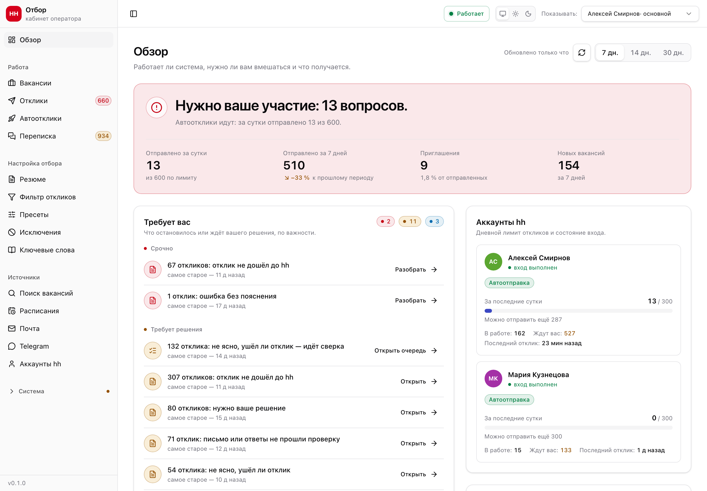

# otbor

**Автоотклики на hh.ru, которые идут до конца: находят вакансии, пишут
сопроводительные письма и ответы на вопросы работодателя, проходят капчу и
отправляют отклик — вашей моделью и под вашим контролем.**



Главная идея: логика отбора, очередь и решения живут в otbor, а «мозги» и
«руки» — локальный харнес с вашей сессией hh и вашей подпиской на модель.
Можно включить полностью автоматическую отправку, а можно остановиться на
черновиках и нажимать «Отправить» самому.

## Что умеет

- **Автоотклик с тремя режимами**: выключено, «черновики» (система сама
  выбирает вакансии, создаёт отклики и пишет письма, отправляете вы) и «авто»
  (готовые отклики уходят на hh.ru сами). Дневной лимит на аккаунт, размер
  партии, минимальный приоритет, «только с письмом», сортировка и
  предпросмотр очереди.
- **Капча hh.ru**: браузер харнеса снимает картинку, при необходимости
  переключает её язык, отдаёт изображение модели с поддержкой vision, вводит
  ответ и жмёт «Отправить». Подойдёт локальный сервер (oMLX, LM Studio).
  Если ответ не принят, аккаунт ставится на паузу, а не спамит повторами.
- **Свой харнес для писем и ответов**: opencode или Claude Code через ACP,
  либо локальная OpenAI-совместимая модель.
- **Классификация вакансий SystemOne**: локальная модель извлекает роль,
  уровень, тип компании, требования к отклику и красные флаги. Каждый факт
  хранится с уверенностью; ниже порога 0.8 он читается как «неизвестно».

## Запуск

Понадобятся **Bun**, **Docker** (Postgres), **Chrome** (вход в hh) и агент для
писем — `opencode` или Claude Code. Пароль hh не нужен: вы входите сами в
открывшемся браузере, сессия сохраняется зашифрованной.

```bash
git clone https://github.com/Artemiy111/otbor.git
cd otbor
bun install
cp .env.example .env
bun run link                # otbor -> ~/.bun/bin/otbor
otbor doctor                # проверит окружение и подскажет, что починить
otbor up                    # Postgres, миграции, server + worker + web
```

`otbor up` поднимает Postgres через docker compose,
применяет миграции и запускает server (RPC на 127.0.0.1:3001), worker и web
(127.0.0.1:5173) с общим логом. Ctrl+C останавливает всё. Флаги:

- `--detach` (`-d`) — в фоне: pid в `~/.otbor/run`, вывод в `logs/<name>.log`;
- `--no-web`, `--harness` (ещё `harness run`), `--proxy` (сначала `proxy up`).

```bash
otbor status          # postgres, api, worker, web, harness
otbor down            # остановить фоновые сервисы; --db ещё и Postgres
```

На новой базе один раз нужен `otbor db seed`. `bun run dev` — то же, что
`otbor up`.

Первые шаги после запуска:

1. Откройте **http://127.0.0.1:5173** и войдите в hh: `otbor hh login`.
   Откроется Chrome, аккаунт появится в разделе «Аккаунты hh».
2. Зарегистрируйте харнес и запустите его (подробности — в разделе «Очередь и
   harness» ниже).
3. Добавьте поисковый URL в «Поиск вакансий» и интервал в «Расписаниях».
4. Настройте «Фильтр откликов» и «Автоотклики»; режим «Авто» включайте, когда
   будете готовы: отправку отозвать нельзя.
5. В «Настройках» включите распознавание капчи и настройте SystemOne для
   классификации вакансий.

## Автоотклики и капча

Страница «Автоотклики»: режим (`off` / черновики / авто), лимит в сутки на
аккаунт hh (у hh свой предел — 200 в день), размер партии (1–500), минимальный
приоритет (соответствие × свежесть, шкала 0–100), сортировка и направление,
галочка «только с письмом», мягкие бусты к соответствию, выбор модели-писателя
и предпросмотр той же выборки, что использует исполнитель. Всё, что требует
человека (непонятная форма, заблокированная подсказка), останавливается с
пометкой «нужен человек», а не угадывается.

Этапы заявки видны в карточке отклика: ждёт, ждёт повтора, читается форма,
пишется письмо, кит готов, отправка, отправлен, нужен человек, ошибка.

Капча настраивается карточкой «Распознавание капчи» в «Настройках»: включение,
модель из каталога харнесов с поддержкой изображений, число попыток (1–10),
таймаут, фильтр картинки перед моделью и язык капчи. Там же — тест на
последней сохранённой картинке и журнал решений. Настройка лежит в
`~/.otbor/captcha.json`, харнес читает её при каждой капче — перезапуск не
нужен. Если модель не справилась за отведённые попытки, аккаунт ставится на
паузу; send-задачи, ждавшие капчу, возвращаются раннеру.

```bash
otbor hh captcha                 # эпизоды: сколько откликов hh пропустил до капчи
otbor hh resume <аккаунт>        # возобновить отправки после капчи вручную
```

## MCP

`otbor mcp` — MCP-сервер на stdio поверх того же `RpcGroup`, что CLI и web.
Нужен запущенный API (`otbor up`).

Чтение: `vacancies_top`, `vacancy_get`, `decisions_list`, `fit_get`, пресеты,
работодатели, резюме, `applications_list`, `application_get`,
`application_form` (вопросы формы, подсказки, статус набора), диалоги,
контакты, расписания, очередь.

Запись (Claude в чате ведёт отклик сам, инструменты атомарные):
`fit_save` (своя оценка fit), `application_prepare` (черновик + открытие формы
hh, идемпотентно), `kit_set` (письмо и ответы; локальная проверка показывает
все проблемы сразу), `application_skip` и `application_approve`.

Безопасность:

- Только `application_approve` реально отправляет отклик на hh.ru, один раз и
  необратимо. Нужен `confirm: true`; инструкции сервера требуют сначала
  показать письмо и ответы и получить согласие пользователя.
- Сервер проверяет набор ещё раз (`AnswersInvalid`), а дневной лимит отправок
  на hh-аккаунт (`OTBOR_DAILY_APPLY_LIMIT`, по умолчанию 200 за 24 часа; лимит аккаунта из `apply_filter.daily_limit`
  имеет приоритет,
  `LimitExceeded`) держит облако, а не MCP.
- `OTBOR_MCP_READONLY=1` регистрирует только инструменты чтения.

В репозитории лежит `.mcp.json`, поэтому Claude Code видит сервер `otbor`
сразу. Для OpenCode:

```jsonc
{ "mcp": { "otbor": { "type": "local", "command": ["otbor", "mcp"], "enabled": true } } }
```

## Корпус, краулер и прокси

```bash
otbor crawl 'https://hh.ru/search/vacancy?text=devops&area=1' --pages 1 --hydrate
otbor hydrate --limit 50 --delay 1000
```

Прокси задаётся один раз:

```bash
otbor proxy set http://127.0.0.1:7897 --endpoint
# или подписка + mihomo
otbor proxy set 'https://sub.example.com/token'
otbor proxy up
otbor proxy test
```

Настройки лежат в `~/.otbor/proxy/config.json` (0600). Поддерживаются только
`OTBOR_PROXY_*`; секреты подписки не попадают в БД, логи или git.

## Расписания обхода

Расписание — это поисковый URL hh.ru и интервал в минутах. Воркер
(`bun run worker`) каждые `WORKER_SCHEDULE_SECONDS` секунд (по умолчанию 60)
забирает созревшие расписания и прогоняет полный обход тем же `CrawlRunner`,
что и ручной обход: worker проходит все страницы выдачи до последней, которую
отдаёт hh.ru, но не больше 100 страниц за запуск. Ошибка одного расписания
пишется в `last_error` и не останавливает остальные.

```bash
otbor schedule list
otbor schedule upsert \
  --target 'https://hh.ru/search/vacancy?text=devops&search_field=name&area=1&order_by=publication_time' \
  --interval 360
otbor schedule run-now --id <id>
otbor schedule remove --id <id>
```

`run-now` только принимает заявку: сам обход идёт в отдельном fiber, поэтому
RPC возвращается до загрузки страницы hh.ru.

## Анализ вакансий (SystemOne)

Локальная модель (`clef-flash-4bit` под omlx) вытаскивает из вакансии факты:
роль, уровень, тип компании, требования к отклику, красные флаги. Каждый факт
хранится с уверенностью; ниже порога 0.8 он читается как «неизвестно».
Сервер читается из окружения: `OTBOR_SYSTEMONE_URL`
(по умолчанию `http://127.0.0.1:1111`), `OTBOR_SYSTEMONE_API_KEY` (секрет, не
логируется), `OTBOR_SYSTEMONE_MODEL` (по умолчанию `clef-flash-4bit`),
`OTBOR_SYSTEMONE_TIMEOUT_MS` (по умолчанию 60000).

```bash
otbor analysis run [--limit 20] [--delay 0] [--json]   # один ограниченный проход
otbor analysis stats                                   # проанализировано / всего
otbor analysis show <id|префикс|hh-URL>                # факты с уверенностью
otbor schedule upsert --kind analysis --target global --interval 30
```

Проход последовательный; если SystemOne недоступен или отклонил ключ, он
останавливается с понятной ошибкой (`stoppedBy`), а не помечает все вакансии
сбойными. Расписание `analysis` принимает опции `limit` (50, максимум 500) и
`delayMs`. Подробности: `docs/architecture/vacancy-analysis.md`.

## Очередь и harness

Регистрация устройства выдаёт токен один раз и сохраняет локальную
конфигурацию CLI:

```bash
otbor harness register \
  --name local \
  --kind browser \
  --kind inference \
  --account <hh-account-id> \
  --save
```

Токен и harness id лежат в `~/.otbor/harness.json` (0600). Дальше воркер
запускается из того же CLI, без shell-обёрток:

```bash
otbor harness run                 # долгоживущий цикл
otbor harness run --once          # один lease и выход
otbor harness run --once --wait 2 # один короткий long-poll
```

`--kind browser` — это руки: харнес берёт cookies hh из облака (`otbor hh
login`), открывает форму отклика, отвечает на вопросы, решает капчу и нажимает
«Откликнуться». `--kind inference` — мозги: `otbor harness run` забирает
задания, запускает `opencode acp` или адаптер Claude Code, шлёт heartbeat и
возвращает текст, модель, usage и `providerResponse` в `HarnessJob.result`.

Локальные OpenAI-совместимые серверы (oMLX, LM Studio, llama.cpp), в том числе
с поддержкой изображений для капчи, добавляются в каталог харнесов:

```bash
otbor harness model add --id omlx --url http://127.0.0.1:8000/v1 --api-key <ключ>
otbor harness model list
otbor harness model remove --id omlx
```

## ACP и inference

```bash
otbor acp session                 # какой агент, модель и configOptions
otbor acp prompt 'Reply with exactly: ok'

otbor inference run 'Напиши одно предложение о вакансии'
otbor inference get <job-id>
```

ACP работает через `opencode acp` (ACP v1) и адаптер Claude Code
(`@agentclientprotocol/claude-agent-acp`, нужна авторизация `claude auth
login`). Codex ACP не предоставляет, поэтому в текущем адаптере не
поддерживается. Модель по умолчанию берётся из конфигурации агента;
`inference run --model` применяется через `session/set_config_option` (если
агент его поддерживает). `OTBOR_ACP_BIN`, `OTBOR_ACP_CWD` и
`OTBOR_ACP_TIMEOUT_SECONDS` переопределяют процесс; `OTBOR_ACP_CWD` намеренно
лежит вне репозитория. Подробности: `docs/acp.md`.

## Письма, ответы и резюме

Письменные задачи идут через ту же очередь: облако собирает промпт, а текст
возвращает inference-харнес. Письмо и ответы на тест пишет один промпт, общий
для веба, автопилота и CLI.

```bash
otbor write draft <application-id> --length short
otbor write draft <application-id> --save

otbor write resume ./resume.txt --target-role "Platform Engineer"
cat resume.txt | otbor write resume --target-role "SRE"
```

`write draft --save` заменяет письмо в существующем kit заявки через
`ApplicationsSetKit`, ответы и `formHash` остаются прежними. Без kit ничего не
создаётся. Подробности: [docs/writing.md](docs/writing.md).

## Наблюдаемость

Сервер и воркер отдают логи, трейсы и метрики по OTLP встроенными модулями
Effect (`effect/observability`). Локальный стек — Loki, Grafana, Tempo, Mimir и
OpenTelemetry Collector — живёт в `compose.observability.yml`:

```bash
bun run obs:up     # Grafana: http://127.0.0.1:3030
bun run obs:down
```

Экспорт включается переменными `OTEL_*` в `.env` (см. `.env.example`); без них
процессы ничего не шлют, а терминальный и файловый логи работают как раньше.
Веб-приложение шлёт трейсы RPC-вызовов через тот же origin (`/otlp`, Vite
проксирует в коллектор), поэтому вызов из интерфейса и его обработка на сервере
видны одним трейсом.
В Grafana уже настроены источники со связями лог → трейс → метрики и дашборд
«otbor: обзор». Конфиги лежат в `infra/observability`.

## Проверки

```bash
bun test
bun run typecheck
bun run test:integration   # временная БД на otbor-postgres:55432
bun run --cwd apps/web build
```

Интеграционные тесты создают одноразовую БД и не трогают демо-базу `otbor`.
